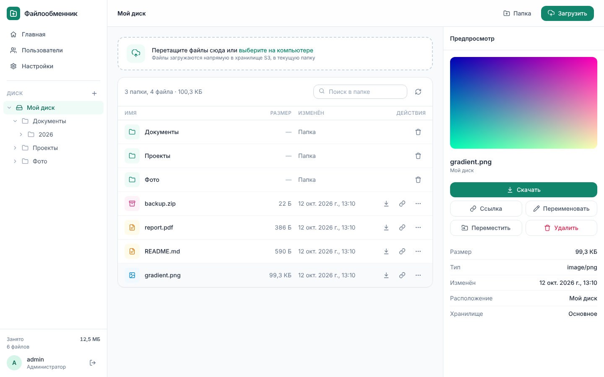
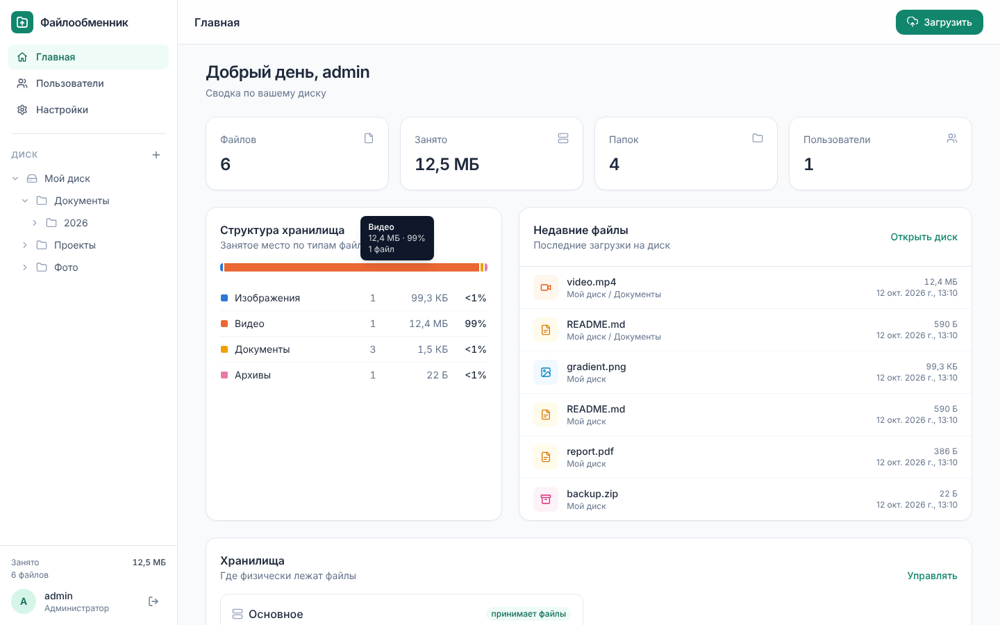
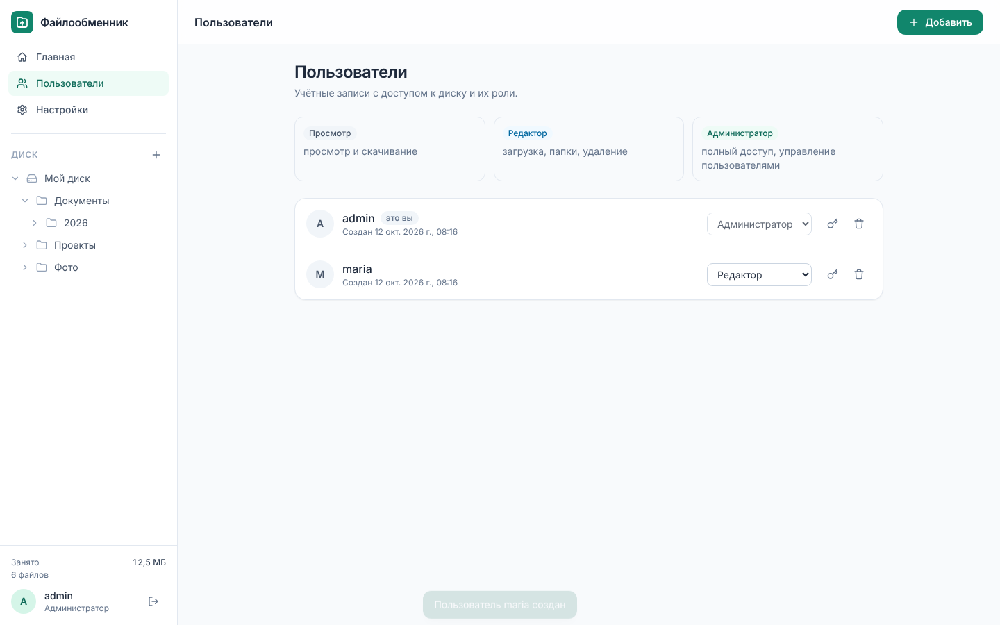
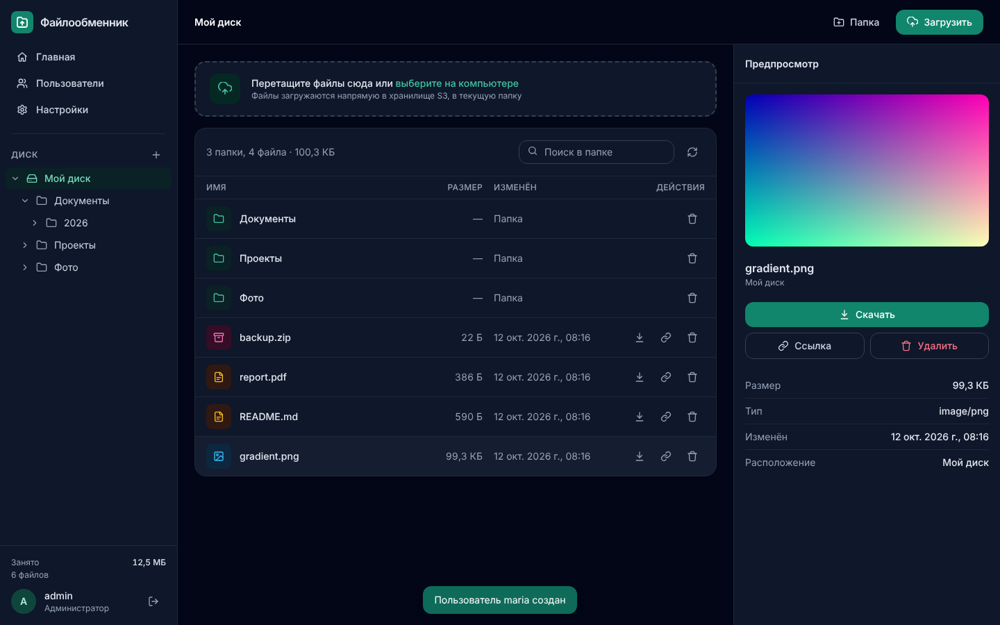
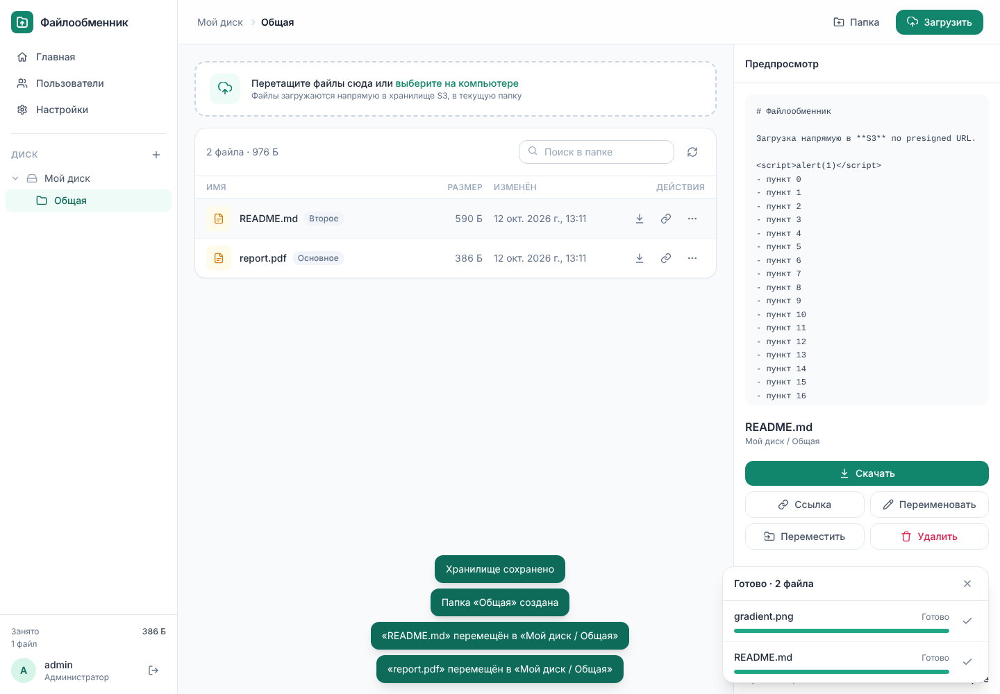
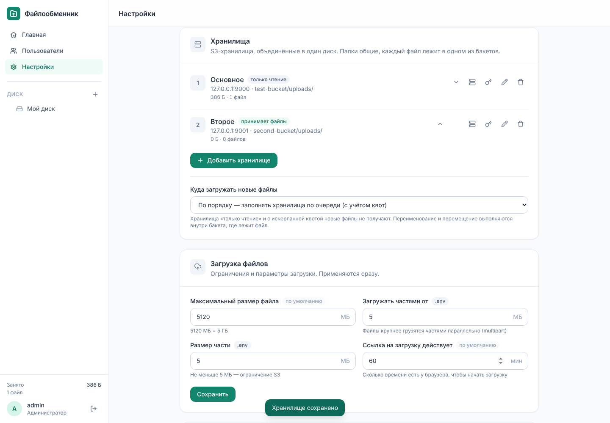
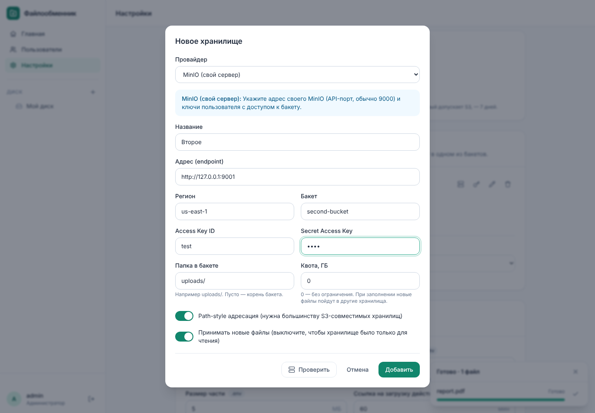

# Файлообменник на S3

Лёгкий self-hosted файлообменник: Node.js + AWS SDK v3 + Tailwind CSS + Vanilla JS.
Загрузка и скачивание идут **напрямую между браузером и S3** по presigned URL — VDS только
подписывает ссылки, поэтому ему хватает **~60 МБ ОЗУ** и почти не нужен канал.
Единственная runtime-зависимость — AWS SDK; все настройки меняются в интерфейсе.



## Возможности

- **Левая панель:** «Главная», «Пользователи», «Настройки» и дерево папок диска
  (ленивая подгрузка, раскрытие пути до текущей папки).
- **Диск:** папки (создание, удаление со всем содержимым), хлебные крошки, поиск в папке,
  drag-and-drop в любое место страницы, очередь загрузок с плавным прогрессом, скоростью,
  оставшимся временем и отменой.
- **Вид «Список» и «Плитки»** с миниатюрами изображений (подгружаются по мере прокрутки),
  **сортировка** по имени, размеру и дате (клик по заголовку столбца или меню).
- **Загрузка папок целиком** — перетаскиванием или кнопкой «папку»: структура подпапок
  сохраняется. **Вставка из буфера** (Ctrl+V) — скриншот загрузится как «Снимок <дата>.png».
- **Выбор нескольких файлов** (флажки, Ctrl/Shift+клик, Ctrl+A): переместить, удалить,
  скопировать ссылки разом; перетаскивание выбранных файлов на папку.
- **Клавиатура:** стрелки, Enter, пробел, F2, Delete, «/» — поиск, «?» — список клавиш,
  **Ctrl+K** — командная палитра (страницы, папки, избранное, действия).
- **Копирование** файлов, **проверка одинаковых имён** при загрузке (заменить / сохранить
  оба / пропустить), **избранное** в левой панели, **недавно открытые** на главной,
  контекстное меню по правому клику, выделение рамкой.
- **Галерея** на весь экран (стрелки, свайп, масштаб); **оформленный предпросмотр**:
  CSV — таблицей, JSON — с отступами, Markdown, подсветка кода; **QR-код** ссылки.
- **Администратору:** журнал действий (#/audit), предупреждение о расхождении часов,
  график роста занятого места и крупные файлы на главной, название и логотип,
  экспорт/импорт настроек для переноса на другой сервер.
- **Безопасность аккаунта:** список устройств, где выполнен вход, с завершением любой сессии;
  **API-токены** для скриптов (полный доступ или только чтение).
- **Пауза и продолжение** загрузки, **ограничение скорости** (Настройки → Интерфейс),
  **загрузка по ссылке** — сервер сам скачивает файл и потоком кладёт в S3.
- **Переименование и перемещение файлов:** меню «⋯» у файла, кнопки в панели предпросмотра,
  клавиша F2, окно выбора папки, перетаскивание файла на папку в списке, в дереве или в
  хлебных крошках. Копирование выполняется внутри S3 (`CopyObject`, для файлов > 5 ГБ —
  `UploadPartCopy`), байты через VDS не идут.
- **Предпросмотр справа:** изображения, видео, аудио, PDF, текст и код (первые 256 КБ),
  свойства файла, «Скачать», «Скопировать ссылку», «Удалить». На телефоне — выезжающая панель.
- **Главная:** сводка (файлы, занятое место, папки, пользователи), структура хранилища по типам,
  недавние файлы.
- **Пользователи и роли:** «Просмотр», «Редактор», «Администратор»; без БД — `data/users.json`.
- **Несколько S3-хранилищ — один диск.** Можно подключить сколько угодно бакетов у разных
  провайдеров: пользователь видит одно дерево папок и один список файлов (с пометкой, где лежит
  файл). Новые файлы распределяются по политике «по порядку» (с квотами) или «балансировка»;
  хранилище можно сделать «только для чтения». Недоступное хранилище не ломает диск.
- **Настройки:** смена пароля, тема (системная/светлая/тёмная), срок ссылок по умолчанию.
  Администратору доступны **все параметры `.env`**: хранилища S3 (с готовыми настройками для
  Yandex, **Cloud.ru**, Selectel, Timeweb, VK Cloud, Cloudflare R2, Amazon S3, MinIO, проверкой
  подключения и автонастройкой CORS), лимиты загрузки, адрес сайта, сессии, HOST/PORT
  (с перезапуском из интерфейса). Изменения применяются сразу и хранятся в `data/settings.json`.
- Файлы до `MULTIPART_THRESHOLD_MB` — одним PUT; крупнее — **multipart** частями
  (3 параллельно, повтор упавших частей), до 5 ТБ.

| Главная | Пользователи | Тёмная тема |
|---|---|---|
|  |  |  |

| Единый диск из двух хранилищ | Хранилища в настройках | Добавление хранилища |
|---|---|---|
|  |  |  |

## Архитектура

```
Браузер ──(1) POST /api/uploads ─────────▶ Node.js ──(создать multipart / подписать)──▶ S3 API
   │    ◀─────────── presigned PUT URL ───────┘
   ├──(2) PUT файл напрямую ─────────────────────────────────────────────────────────▶ S3
   ├──(3) POST /api/uploads/complete ──────▶ Node.js ──(HEAD/ListParts, проверка размера)▶ S3
   └──(4) POST /api/files/link ────────────▶ Node.js → presigned GET → браузер качает с S3
```

## Память

| | В простое | После входов и нагрузки |
|---|---|---|
| Первая версия (Express + helmet) | ~77 МБ | ~125 МБ |
| Сейчас | **~58 МБ** | **~62 МБ** |

За счёт чего:
- **Свой HTTP-слой** (`src/http.js`, ~250 строк на `node:http`) вместо Express 5 и helmet:
  у Express глубокое дерево зависимостей (`qs`, `body-parser`, `send`, `router`, `iconv-lite`…).
  API совместимый (`Router`, `req.body`, `res.json`, обработчики ошибок), так что роуты не изменились.
- **`node:http` загружается через `require`**: ESM-импорт в Node 22 подтягивал встроенный
  undici (fetch/WebSocket), который приложению не нужен.
- **Флаги V8**: `--jitless --optimize-for-size --max-old-space-size=64 --max-semi-space-size=1`.
  Без JIT V8 экономит ~15 МБ; приложение ждёт сеть, а не считает, так что скорость не падает.
- **Аллокатор glibc** (`MALLOC_ARENA_MAX=2 MALLOC_TRIM_THRESHOLD_=131072`): каждый вход по
  паролю — это scrypt с буфером 16 МБ в пуле потоков. По умолчанию glibc оставляет эту память
  в куче процесса, и после нескольких входов RSS вырастал до 120+ МБ. С этими переменными
  память сразу возвращается системе.
- Сравнение строк на сервере без `localeCompare` (он подгружает данные ICU, ~5 МБ):
  сортировка «по-русски» выполняется в браузере.
- Рекурсивное удаление папки идёт пачками по 1000 ключей, без накопления списка в памяти.

Переменные и флаги уже прописаны в `npm start`, `ecosystem.config.cjs` (PM2) и
`deploy/file-manager.service` (systemd; установка — `sudo bash deploy/install-systemd.sh --user USER`).

## Несколько хранилищ как единый диск

```
                    ┌──────────── единый диск ────────────┐
   Мой диск/        │  Основное (Yandex)   Архив (Cloud.ru) │
   ├── Документы/   │  Документы/…         Документы/…      │  ← папки общие:
   │   ├── отчёт.pdf│  отчёт.pdf                            │    есть во всех бакетах
   │   └── план.xlsx│                      план.xlsx        │  ← файл — в одном бакете
   └── фото.jpg     │                      фото.jpg         │
                    └───────────────────────────────────────┘
```

- **Список папки** собирается из всех хранилищ параллельно и сливается в один упорядоченный
  список (новые сверху). Ключи во всех бакетах одного формата, поэтому слияние точное, а
  постраничный курсор — просто последний выданный ключ (`ListObjectsV2 StartAfter`).
- **Файл в API** адресуется ссылкой `<id хранилища>:<ключ>`; скачивание, предпросмотр,
  переименование и перемещение выполняются в бакете, где файл лежит.
- **Новый файл** попадает в хранилище по политике: «по порядку» — первое в списке, где есть
  место по квоте; «балансировка» — наименее заполненное. Хранилища «только чтение» и
  недоступные (не ответили за последнюю минуту) пропускаются.
- **Папки** создаются и удаляются во всех хранилищах сразу.
- **Отказоустойчивость:** если бакет не отвечает, диск работает с остальными и показывает
  предупреждение; файлы недоступного хранилища появятся, когда оно вернётся.
- Отключение хранилища в настройках не удаляет файлы из бакета — подключите его снова, и они
  вернутся на диск.

## Хранение в S3

Папка — это S3-префикс (пустая папка хранится как объект-маркер `путь/`). Файл лежит прямо
в своей папке: `uploads/<папка>/<время-по-убыванию>-<случайный id>~<имя>`. Инвертированное
время даёт сортировку «новые сверху» прямо в `ListObjectsV2`, случайный id делает ключ неугадываемым.

В S3 нет операции «переименовать»: файл копируется под новым ключом и исходный удаляется.
Id в ключе при этом сохраняется, поэтому файл остаётся на своём месте в списке. Ссылки,
выданные на старый ключ, после переименования или перемещения перестают работать.

## Структура проекта

```
├── src/
│   ├── server.js              # сборка приложения: middleware, роуты, статика, graceful shutdown
│   ├── http.js                # лёгкий HTTP-слой с Express-совместимым API (без зависимостей)
│   ├── config.js              # настройки: .env + data/settings.json, проверка, применение на лету
│   ├── storages.js            # несколько хранилищ как единый диск: слияние, размещение, статистика
│   ├── s3.js                  # одно хранилище (класс Storage, AWS SDK v3), presigned URL
│   ├── keys.js                # ключи, папки, ссылки «хранилище:ключ», санитизация, предпросмотр
│   ├── users.js               # пользователи и роли (data/users.json)
│   ├── auth.js                # сессии (HMAC-токен в cookie), requireAuth / requireRole
│   ├── password.js            # scrypt-хеширование пароля
│   ├── middleware/security.js # заголовки безопасности/CSP, проверка Origin, rate limit, ошибки
│   └── routes/
│       ├── auth.js            # вход/выход, профиль, смена пароля
│       ├── files.js           # папки, файлы, загрузка, предпросмотр, статистика
│       ├── users.js           # управление пользователями (админ)
│       └── settings.js        # все настройки сервера, проверка S3, CORS, перезапуск (админ)
├── public/                    # фронтенд (сборка на сервере не нужна)
│   ├── index.html, login.html, favicon.svg
│   ├── css/app.css            # собранный Tailwind (коммитится)
│   └── js/
│       ├── app.js             # оболочка: роутер, левая панель, очередь загрузок
│       ├── tree.js            # дерево папок
│       ├── folder-picker.js   # окно выбора папки для перемещения
│       ├── preview.js         # правая панель предпросмотра
│       ├── views/             # home.js, disk.js, users.js, settings.js, settings-admin.js
│       ├── s3-presets.js      # готовые настройки S3-провайдеров (в т.ч. Cloud.ru)
│       ├── api.js, uploader.js, ui.js, theme.js, login.js
├── frontend/tailwind.css      # исходник стилей
├── scripts/                   # hash-password.js, apply-cors.js
├── deploy/                    # nginx.conf.example, file-manager.service, s3-cors.json, s3-lifecycle.json
├── docs/DEPLOY_FASTPANEL.md   # пошаговый деплой
├── test/                      # node --test
├── ecosystem.config.cjs       # PM2
└── .env.example
```

## API

Все маршруты, кроме входа, требуют сессии. Изменяющие запросы принимаются только с `APP_ORIGIN`.
Роль: 👁 — любой вошедший, ✏️ — редактор и выше, 🔑 — администратор.

| Метод | Путь | Роль | Описание |
|---|---|---|---|
| POST | `/api/auth/login` | — | `{username, password}` → cookie сессии |
| POST | `/api/auth/logout` | — | выход |
| GET | `/api/auth/me` | 👁 | текущий пользователь |
| POST | `/api/auth/password` | 👁 | `{currentPassword, newPassword}` |
| GET | `/api/stats` | 👁 | сводка: файлы, размер, типы, недавние |
| GET | `/api/files?folder=a/b/&cursor=` | 👁 | `{folders, files, nextCursor}` |
| POST | `/api/files/link` | 👁 | `{key, ttl: 3600\|86400\|604800}` → ссылка на скачивание |
| POST | `/api/files/preview` | 👁 | `{key}` → `{kind, url, size, contentType}` (inline, 15 мин) |
| POST | `/api/files/copy` | ✏️ | `{key, folder?, name?}` → копия в том же бакете (CopyObject) |
| POST | `/api/uploads/url` | ✏️ | `{url, folder}` → 202 `{job}`; статус `GET /api/uploads/url/:id`, отмена `POST …/:id/cancel` |
| POST | `/api/files/thumbs` | 👁 | `{keys}` (до 200) → `{urls: {key: url}}` — миниатюры изображений, только подпись (15 мин) |
| POST | `/api/folders` | ✏️ | `{parent, name}` — создать папку |
| POST | `/api/folders/delete` | ✏️ | `{path}` — удалить папку рекурсивно |
| POST | `/api/uploads` | ✏️ | `{name, size, type, folder, subfolders?}` → single PUT или multipart; `subfolders` — путь внутри загружаемой папки |
| POST | `/api/uploads/parts` | ✏️ | `{key, uploadId, partNumbers[]}` → presigned URL частей |
| POST | `/api/uploads/complete` | ✏️ | `{key, uploadId?}` — завершить и проверить размер |
| POST | `/api/uploads/abort` | ✏️ | `{key, uploadId}` |
| POST | `/api/files/move` | ✏️ | `{key, folder?, name?}` — переименовать и/или переместить |
| DELETE | `/api/files?key=` | ✏️ | удалить файл |
| GET/POST | `/api/users`, PATCH/DELETE `/api/users/:username` | 🔑 | пользователи и роли |
| GET / PUT | `/api/settings` | 🔑 | все настройки (секреты не отдаются) / сохранить `{values}` |
| POST | `/api/settings/reset` | 🔑 | `{keys}` — вернуть значения из `.env` |
| POST / PUT / DELETE | `/api/settings/storages[/:id]` | 🔑 | добавить / изменить / отключить хранилище (с проверкой подключения и автонастройкой CORS) |
| POST | `/api/settings/storages/check` | 🔑 | `{storage, id?}` — проверить подключение (в т.ч. несохранённое) |
| POST | `/api/settings/storages/:id/cors` | 🔑 | применить CORS к бакету |
| PUT | `/api/settings/storages-order`, `/api/settings/placement` | 🔑 | порядок хранилищ, политика размещения |
| POST | `/api/settings/sessions/reset` | 🔑 | новый секрет сессий — все выйдут |
| POST | `/api/settings/restart` | 🔑 | перезапуск процесса (для HOST/PORT) |

## API-токены (скрипты)

Создайте токен в **Настройки → API-токены** (показывается один раз). Запросы — с заголовком
`Authorization: Bearer <токен>`; проверка Origin для них не нужна (без cookie CSRF невозможен).

```bash
T=fmt_xxxxxxxxxxxx_...           # токен
U=https://files.example.com
# список файлов в корне
curl -H "Authorization: Bearer $T" "$U/api/files?folder="
# загрузка файла: 1) план, 2) PUT прямо в S3, 3) завершение
F=backup.tar.gz; SIZE=$(stat -c %s "$F")
PLAN=$(curl -s -H "Authorization: Bearer $T" -H 'content-type: application/json' \
  -d "{\"name\":\"$F\",\"size\":$SIZE,\"folder\":\"Бэкапы/\"}" "$U/api/uploads")
CT=$(echo "$PLAN" | jq -r '.headers["Content-Type"]')
SC=$(echo "$PLAN" | jq -r '.headers["X-Amz-Storage-Class"] // empty')
curl -sf -X PUT -H "Content-Type: $CT" ${SC:+-H "X-Amz-Storage-Class: $SC"} \
  --data-binary @"$F" "$(echo "$PLAN" | jq -r .url)"
curl -s -H "Authorization: Bearer $T" -H 'content-type: application/json' \
  -d "{\"key\":\"$(echo "$PLAN" | jq -r .key)\"}" "$U/api/uploads/complete"
```

Файлы больше `MULTIPART_THRESHOLD_MB` сервер отдаёт как multipart (`mode: "multipart"`): части
грузятся по ссылкам из `POST /api/uploads/parts`. Токен «только чтение» разрешает лишь GET.
Создавать и отзывать токены можно только из обычного входа, не токеном.

## Безопасность

Аудит, исправленные проблемы, остаточные риски и рекомендации — в [SECURITY.md](SECURITY.md).

## Локальный запуск

```bash
npm install
cp .env.example .env              # APP_ORIGIN=http://localhost:3000 и хеш пароля
npm run hash-password             # → ADMIN_PASSWORD_HASH (первый администратор)
npm run dev                       # http://localhost:3000 → Настройки → Хранилища
npm run watch:css                 # если меняете вёрстку
npm test
```

После изменения HTML/JS выполните `npm run build:css` и закоммитьте `public/css/app.css`.

## Деплой

См. **[docs/DEPLOY_FASTPANEL.md](docs/DEPLOY_FASTPANEL.md)** — создание сайта в FastPanel,
Nginx reverse proxy, PM2 / systemd, SSL, CORS бакета.
