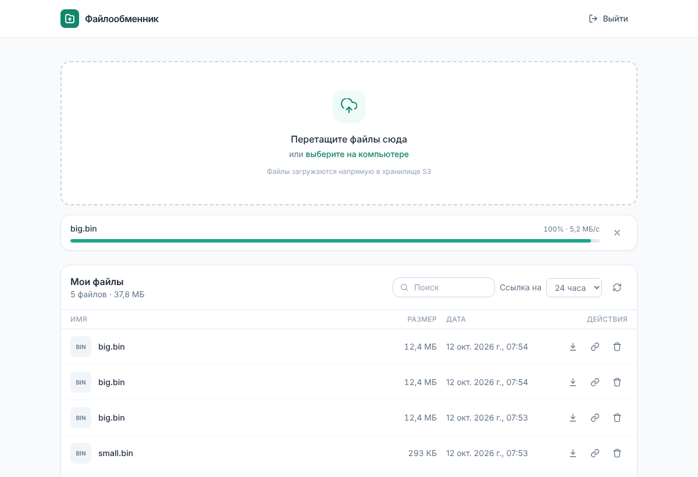

# Файлообменник на S3

Лёгкий self-hosted файлообменник: Node.js (Express 5) + AWS SDK v3 + Tailwind CSS + Vanilla JS.
Загрузка и скачивание идут **напрямую между браузером и S3** по presigned URL — VDS только
подписывает ссылки, поэтому ему хватает ~80–90 МБ ОЗУ и почти не нужен канал.



## Возможности

- Drag-and-Drop и выбор файлов, очередь загрузок, прогресс-бар со скоростью, отмена.
- Файлы до `MULTIPART_THRESHOLD_MB` — одним PUT; крупнее — **multipart** частями
  (3 параллельно, повтор упавших частей), до 5 ТБ.
- Список файлов (имя, размер, дата), поиск, постраничная подгрузка; новые сверху.
- «Скопировать ссылку для скачивания» на 1 час / 24 часа / 7 дней, «Скачать», «Удалить».
- Вход по паролю, светлая/тёмная тема, адаптивная вёрстка.

## Архитектура

```
Браузер ──(1) POST /api/uploads ─────────▶ Node.js ──(создать multipart / подписать)──▶ S3 API
   │    ◀─────────── presigned PUT URL ───────┘
   ├──(2) PUT файл напрямую ─────────────────────────────────────────────────────────▶ S3
   ├──(3) POST /api/uploads/complete ──────▶ Node.js ──(HEAD/ListParts, проверка размера)▶ S3
   └──(4) POST /api/files/link ────────────▶ Node.js → presigned GET → браузер качает с S3
```

## Структура проекта

```
├── src/
│   ├── server.js             # Express: middleware, роуты, статика, graceful shutdown
│   ├── config.js             # загрузка и валидация .env
│   ├── s3.js                 # S3-клиент (AWS SDK v3) и presigned URL
│   ├── keys.js               # генерация/валидация ключей, санитизация имён, Content-Disposition
│   ├── auth.js               # сессии (HMAC-токен в cookie), requireAuth
│   ├── password.js           # scrypt-хеширование пароля
│   ├── middleware/security.js# helmet/CSP, проверка Origin, rate limit, обработчик ошибок
│   └── routes/
│       ├── auth.js           # /api/auth/login|logout|me
│       └── files.js          # /api/files, /api/uploads/*
├── public/                   # фронтенд (отдаётся как есть, сборка на сервере не нужна)
│   ├── index.html, login.html, favicon.svg
│   ├── css/app.css           # собранный Tailwind (коммитится)
│   └── js/app.js, api.js, uploader.js, login.js
├── frontend/tailwind.css     # исходник стилей
├── scripts/                  # hash-password.js, apply-cors.js
├── deploy/                   # nginx.conf.example, file-manager.service, s3-cors.json, s3-lifecycle.json
├── docs/DEPLOY_FASTPANEL.md  # пошаговый деплой
├── test/                     # node --test
├── ecosystem.config.cjs      # PM2
└── .env.example
```

## API

Все маршруты, кроме `/api/auth/*`, требуют входа. Изменяющие запросы принимаются только с `APP_ORIGIN`.

| Метод | Путь | Тело / параметры | Ответ |
|---|---|---|---|
| POST | `/api/auth/login` | `{password}` | cookie сессии |
| POST | `/api/auth/logout` | — | — |
| GET | `/api/files` | `?cursor=` | `{files:[{key,name,size,lastModified}], nextCursor}` |
| POST | `/api/uploads` | `{name,size,type}` | `{mode:'single',key,url,headers}` или `{mode:'multipart',key,uploadId,partSize,partCount}` |
| POST | `/api/uploads/parts` | `{key,uploadId,partNumbers[]}` | `{urls:{n:url}}` |
| POST | `/api/uploads/complete` | `{key, uploadId?}` | `{file}` |
| POST | `/api/uploads/abort` | `{key,uploadId}` | — |
| POST | `/api/files/link` | `{key, ttl: 3600\|86400\|604800}` | `{url, expiresAt}` |
| DELETE | `/api/files` | `?key=` | — |

## Локальный запуск

```bash
npm install
cp .env.example .env              # APP_ORIGIN=http://localhost:3000, данные S3
npm run hash-password             # → ADMIN_PASSWORD_HASH
npm run s3:cors                   # CORS для бакета
npm run dev                       # http://localhost:3000
npm run watch:css                 # если меняете вёрстку
npm test
```

После изменения HTML/JS выполните `npm run build:css` и закоммитьте `public/css/app.css`.

## Деплой

См. **[docs/DEPLOY_FASTPANEL.md](docs/DEPLOY_FASTPANEL.md)** — создание сайта в FastPanel,
Nginx reverse proxy, PM2 / systemd, SSL, CORS бакета.
